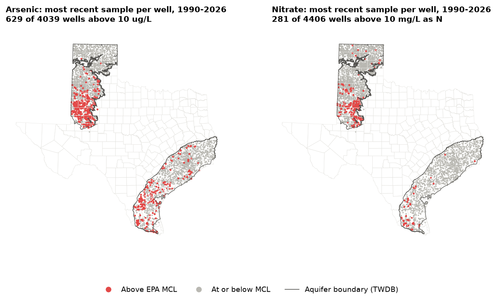
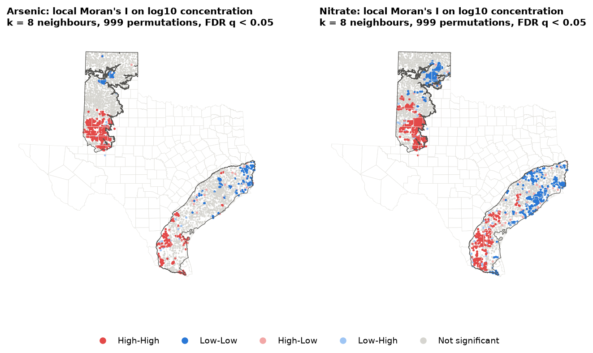
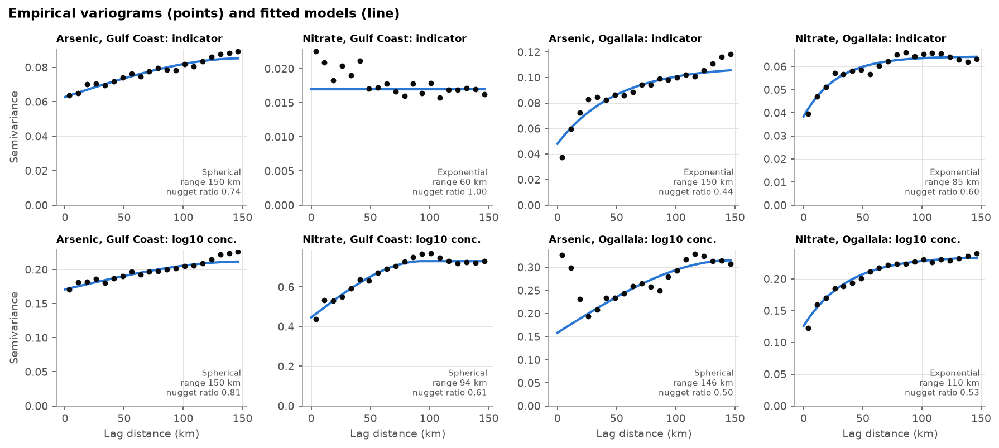
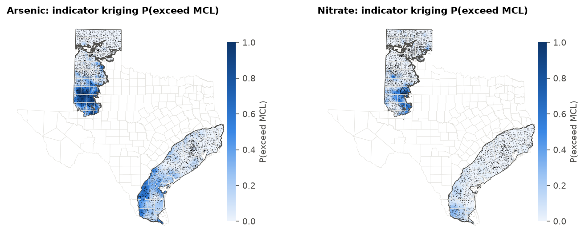
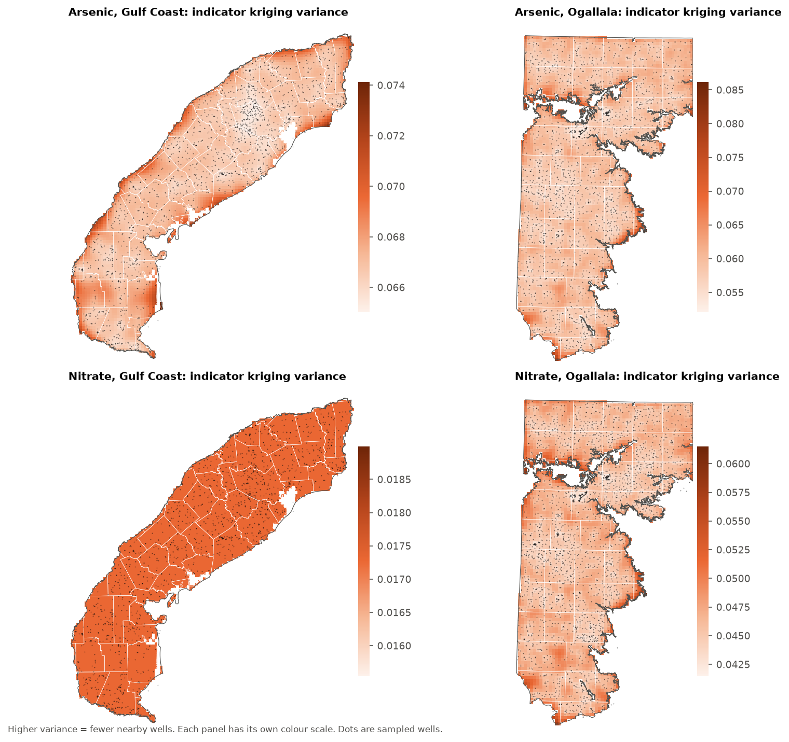
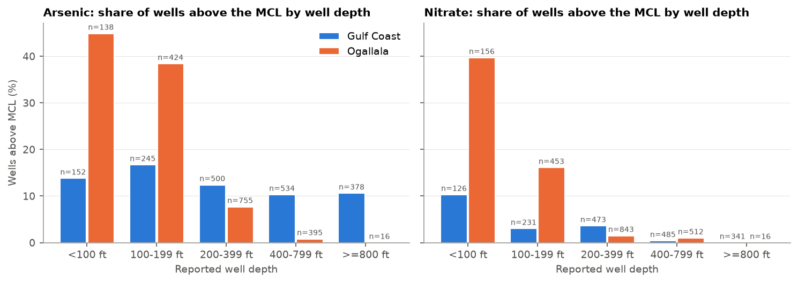
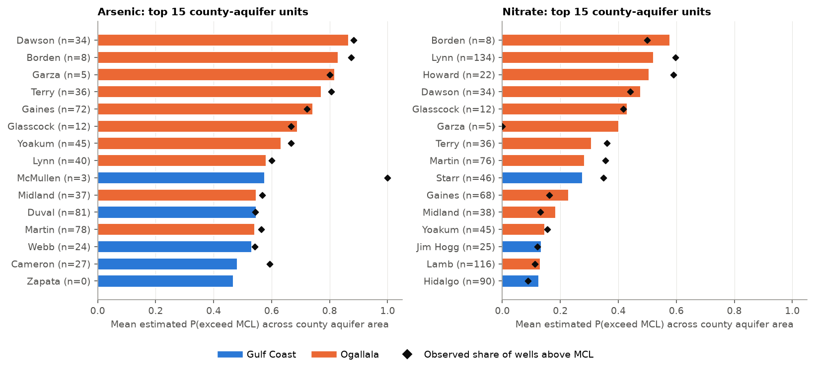
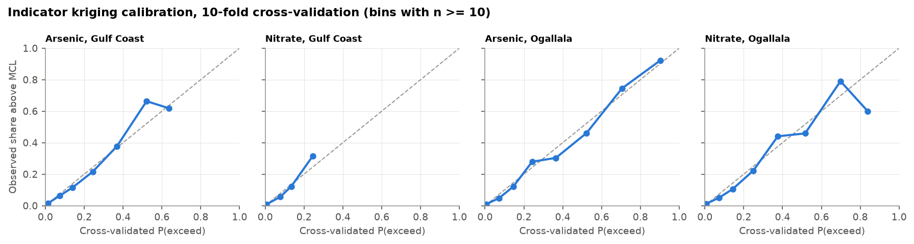

# Arsenic and Nitrate in Texas Groundwater: Spatial Statistics and Kriging of MCL Exceedance

**Author:** Anamika Dristi, Ph.D.

This project maps where groundwater in two major Texas aquifers, the Gulf Coast and the Ogallala (including the Southern High Plains), is likely to exceed the U.S. EPA drinking water limits for arsenic (10 ug/L) and nitrate (10 mg/L as N). It uses the most recent sample from each well in the Texas Water Development Board (TWDB) Groundwater Database for 1990 to 2026: 4,059 wells with arsenic results and 4,416 with nitrate results. The workflow covers global and local spatial autocorrelation (Moran's I, LISA), variogram modelling, indicator kriging of exceedance probability with 10-fold cross-validation, ordinary kriging of log concentration as a check, well depth and aquifer as covariates, and a county ranking with the kriging variance kept as an uncertainty layer. Arsenic exceedance is most likely in the Southern High Plains Ogallala (Dawson, Borden, Garza, Terry and Gaines counties all have a mean estimated probability above 0.7) and in the South Texas Gulf Coast (McMullen, Duval and Webb, about 0.53 to 0.58). Nitrate exceedance is concentrated in the same Southern High Plains counties and is rare in the Gulf Coast outside Starr County.

This is an independent analysis of public data. It is separate from my LSU dissertation datasets and uses none of them.

## Why it matters

- **Private wells are not covered by the Safe Drinking Water Act.** Public water systems must test and treat for arsenic and nitrate, but nobody requires a household well to be tested. In this dataset, the share of domestic wells above the MCL was 22.5% for arsenic in the Ogallala (569 wells) and 14.0% for nitrate in the Ogallala (752 wells). A map of where exceedance is likely shows where outreach and free testing programs would reach the most people at risk.
- **Environmental health and GIS work.** The workflow matches what state health and environmental agencies, groundwater conservation districts and university extension programs do: clean a large public database, handle nondetects, test for spatial clustering, krige with cross-validation, and report results by county with uncertainty.
- **Water quality science.** Nitrate in the High Plains comes from fertilizer and other land use above a shallow aquifer. Arsenic in both aquifers is largely geogenic (volcanic ash in the Ogallala, and sediments linked to uranium in South Texas). The depth patterns here are consistent with both.

## Important framing: exceedance estimates, not exposure

The maps estimate the probability that **raw groundwater** at a location and depth like the sampled wells would be above the MCL. They are **not** measurements of what anyone drinks. Exposure depends on which aquifer and depth a household well taps, whether the water is treated (for example, reverse osmosis), and how much is consumed. Public supply well samples in the GWDB are raw well water, not finished water delivered to customers. The county ranking points to places where testing is most worthwhile. It does not count people exposed.

## Data sources

| Dataset | Provider | Link | Notes |
|---|---|---|---|
| Groundwater Database (GWDB) bulk download, `GWDBDownload.zip` (files `WaterQualityMajor.txt`, `WellMain.txt`) | Texas Water Development Board | https://www.twdb.texas.gov/groundwater/data/GWDBDownload.zip (listed at https://www.twdb.texas.gov/groundwater/data/index.asp) | 83,386,005 bytes; files dated 2026-10-22; accessed 2026-10-23. Keyless. |
| Major aquifers of Texas, `major_aquifers.zip` (`NEW_major_aquifers_dd.shp`) | Texas Water Development Board GIS data | https://www.twdb.texas.gov/mapping/gisdata/doc/major_aquifers.zip | Outcrop (code 1) and subsurface (code 2) polygons dissolved per aquifer; accessed 2026-10-23. |
| 2023 cartographic boundary counties, 1:500,000 | U.S. Census Bureau | https://www2.census.gov/geo/tiger/GENZ2023/shp/cb_2023_us_county_500k.zip | Filtered to Texas (STATEFP 48); accessed 2026-10-23. |

Parameter codes used from the GWDB:

- **Arsenic:** 01000 (dissolved, ug/L), with 01002 (total) used only if no dissolved result exists for that sample.
- **Nitrate as N:** 00618 (nitrate as N), then 00631 (nitrite plus nitrate as N), then 71851 (nitrate as NO3, converted to N by multiplying by 14.0067/62.0049).

The Water Quality Portal, listed as a fallback in the plan, was not needed because the TWDB download was available.

## Methods

1. **Screening** (`02_prepare_wells.py`). From 46,288 arsenic and nitrate records in the two aquifers, the script keeps samples from 1990 onward. It drops records flagged "Not indicative of aquifer quality", records with flags other than none or "<", and records with no date. That leaves 30,518 records.
2. **Censoring.**
   - A detected value above the MCL counts as an exceedance (1).
   - A detected value at or below the MCL counts as 0.
   - A nondetect ("<") with a reporting limit at or below the MCL counts as 0.
   - A nondetect with a reporting limit above the MCL is indeterminate and dropped.
   - For concentration statistics and ordinary kriging, a nondetect is set to half its reporting limit.
3. **Most recent sample per well.** For each well and analyte, the most recent determinate sample is kept. Coordinates and reported well depth come from `WellMain.txt`. Wells that share coordinates are reduced to the most recent record before spatial analysis, which removes 20 arsenic wells and 10 nitrate wells.
4. **Spatial autocorrelation** (`03_spatial_autocorrelation.py`).
   - Global Moran's I on log10 concentration and on the 0/1 exceedance indicator.
   - Local Moran's I (LISA) on log10 concentration, with significance set by a Benjamini-Hochberg false discovery rate (q < 0.05).
   - Weights: 8 nearest neighbours, row-standardised, in NAD83 Texas Centric Albers Equal Area (EPSG:3083); 999 permutations.
5. **Covariates** (`04_covariates_depth_aquifer.py`).
   - Exceedance rate by well-depth class.
   - Logistic regression `exceed ~ aquifer * log10(depth)` per analyte, with standard errors clustered by county within aquifer.
6. **Variograms and kriging** (`05_variogram_kriging.py`).
   - Empirical isotropic variograms (gstools) in 20 lag bins out to 150 km.
   - Spherical and exponential models with a nugget are fitted, and the better fit (R squared) is kept. Range and sill are bounded to the lag window, so a regional trend cannot push the range to thousands of km.
   - Ordinary kriging (PyKrige) uses the 64 nearest wells on a 5 km grid clipped to each aquifer inside Texas.
   - Indicator kriging (IK) of the exceedance indicator gives P(exceed), clipped to 0 to 1.
   - Ordinary kriging (OK) of log10 concentration gives a second P(exceed) under a lognormal assumption, used as a sensitivity check.
   - Kriging variance is saved as the uncertainty layer.
   - 10-fold cross-validation, with the variogram held at the full-data fit, gives Brier score, Brier skill against the aquifer-wide rate, AUC, and log-scale RMSE and mean standardised squared error (MSSE).
7. **County ranking** (`06_county_ranking_and_maps.py`). Grid cells are assigned to counties. For each county and aquifer with at least 100 km2 of aquifer, the script reports:
   - mean IK P(exceed);
   - share of the area with P > 0.5;
   - mean kriging variance;
   - median distance to the nearest sampled well;
   - observed wells and exceedances.

## Key findings

All numbers come from the run included in this repository (tables in `outputs/tables/`).

**Observed exceedance, most recent sample per well, 1990 to 2026** (`table1_well_summary.csv`)

| Analyte | Aquifer | Wells | Nondetects | Wells above MCL | Domestic wells above MCL |
|---|---|---|---|---|---|
| Arsenic | Gulf Coast | 1,936 | 50.4% | 257 (13.3%) | 14.3% of 509 |
| Arsenic | Ogallala | 2,123 | 26.8% | 373 (17.6%) | 22.5% of 569 |
| Nitrate | Gulf Coast | 1,775 | 49.2% | 47 (2.6%) | 4.2% of 506 |
| Nitrate | Ogallala | 2,641 | 0.9% | 235 (8.9%) | 14.0% of 752 |

The median sample year is 2000 to 2003, so many "most recent" results are 20 or more years old.

**Spatial clustering** (`table3`, `table4`, `table5`)

- Every analyte and aquifer combination shows strong positive autocorrelation (permutation p = 0.001 in all eight tests).
- Moran's I on log10 concentration: 0.69 for Ogallala arsenic, 0.52 for Gulf Coast nitrate, 0.42 for Ogallala nitrate and 0.37 for Gulf Coast arsenic.
- LISA High-High clusters (FDR q < 0.05):
  - Ogallala arsenic: 323 wells, mostly in Gaines, Martin, Dawson, Yoakum and Midland.
  - Ogallala nitrate: 402 wells, led by Lynn County with 127.
  - Gulf Coast arsenic: 182 wells, led by Duval, Nueces, Cameron and Starr.
  - Gulf Coast nitrate: 293 wells, led by Duval, Starr and Hidalgo.

**Depth** (`table6`, `table7`, figure 6)

- In the Ogallala, exceedance falls steeply with well depth:
  - arsenic: 44.9% of wells under 100 ft and 0.8% of wells 400 to 799 ft;
  - nitrate: 39.7% and 1.0%.
- Per tenfold increase in depth, the county-clustered odds ratio in the Ogallala is 0.011 for arsenic (95% CI 0.004 to 0.029) and 0.006 for nitrate (0.002 to 0.022).
- In the Gulf Coast, depth matters for nitrate (OR 0.095, 0.039 to 0.229) but only weakly for arsenic (OR 0.64, 0.39 to 1.05, p = 0.08).
- Caution: in the Ogallala, depth is tied to geography. The aquifer is thin in the south, where wells are shallow and concentrations are high, so the depth effect is partly a location effect.

**Variograms and cross-validation** (`table8`, figures 3 and 8)

| Analyte, aquifer | IK model, range, nugget ratio | CV AUC (IK) | CV Brier skill vs. aquifer-wide rate | OK log10 RMSE, MSSE |
|---|---|---|---|---|
| Arsenic, Gulf Coast | Spherical, 150 km (at bound), 0.74 | 0.86 | 0.27 | 0.44, 1.07 |
| Arsenic, Ogallala | Exponential, 150 km (at bound), 0.44 | 0.94 | 0.55 | 0.35, 0.72 |
| Nitrate, Gulf Coast | Pure nugget, 1.00 | 0.88 | 0.10 | 0.73, 1.04 |
| Nitrate, Ogallala | Exponential, 85 km, 0.60 | 0.90 | 0.35 | 0.40, 1.07 |

- Indicator kriging separates exceeding from non-exceeding wells well under cross-validation: AUC 0.86 to 0.94.
- It improves on a flat aquifer-wide rate for all four combinations.
- The calibration curves (figure 8) lie close to the 1:1 line up to about P = 0.6.
- The lognormal OK check gave similar AUCs: 0.84 to 0.94.
- Two indicator ranges stopped at the 150 km bound, which means those variograms keep rising across the region (a trend) rather than levelling off.
- Gulf Coast nitrate has too few exceedances (2.6%) for an indicator variogram, so its IK surface is effectively a local moving average.

**Area and counties** (`table9`, `table10`, figures 4, 5, 7)

Share of the kriged aquifer area with estimated P(exceed) above 0.5:

| Analyte | Aquifer | Area with P > 0.5 | Share of the kriged area |
|---|---|---|---|
| Arsenic | Ogallala | 16,125 km2 | 17% of 94,000 km2 |
| Arsenic | Gulf Coast | 6,425 km2 | 6% of 106,375 km2 |
| Nitrate | Ogallala | 4,475 km2 | 5% |
| Nitrate | Gulf Coast | 0 km2 | 0% |

Top counties by mean estimated P(exceed):

- **Arsenic:**
  - Ogallala: Dawson 0.87, Borden 0.83, Garza 0.82, Terry 0.77, Gaines 0.74, Glasscock 0.69.
  - Gulf Coast: McMullen 0.58, Duval 0.55, Webb 0.53.
- **Nitrate:**
  - Ogallala: Borden 0.58, Lynn 0.52, Howard 0.51, Dawson 0.48.
  - Gulf Coast: Starr 0.28, which has the highest value there.

Read low-count counties with care. For example, Garza has 5 observed wells and McMullen has 3, so their estimates lean on wells in neighbouring counties. The `n_wells_observed` and `median_dist_nearest_well_km` columns are there to make this visible.

## Figures


*Figure 1. Most recent sample per well. Red: above the EPA MCL.*


*Figure 2. Local Moran's I clusters of log10 concentration (FDR q < 0.05).*


*Figure 3. Empirical variograms and fitted models for the indicator (top) and log10 concentration (bottom).*


*Figure 4. Indicator kriging estimate of P(exceed MCL) on a 5 km grid. Dots are sampled wells.*


*Figure 5. Indicator kriging variance. Each panel has its own scale. Variance is highest at aquifer edges and in gaps between wells.*


*Figure 6. Share of wells above the MCL by reported well depth.*


*Figure 7. Top 15 county and aquifer units by mean estimated P(exceed). Diamonds show the observed share of wells above the MCL; n is the number of observed wells.*


*Figure 8. Cross-validated calibration of indicator kriging.*

## Limitations

- **Exceedance, not exposure.** See the framing section above. No information on household water treatment, consumption or population is used.
- **Old and uneven sampling.** The most recent sample at many wells is from the 1990s or 2000s, and sampling density differs by county. Concentrations may have changed since then, especially nitrate.
- **Two dimensions only.** Both aquifers are layered (the Gulf Coast includes the Chicot, Evangeline and Jasper units), and kriging in 2D mixes depths. Depth is analysed separately, not built into the kriging.
- **Nondetects and reporting limits.** About half of the Gulf Coast arsenic and nitrate results are nondetects with varying reporting limits. The 0/1 indicator handles this cleanly. The log-concentration surfaces and the LISA results depend on the half-reporting-limit substitution, and part of the Gulf Coast nitrate Low-Low clustering may reflect lower reporting limits in some areas.
- **Variogram fits.** The fits are imperfect in some cases:
  - Two indicator ranges sit at the 150 km bound.
  - The Ogallala arsenic log-concentration variogram has high semivariance at the shortest lags, so its fit R squared is negative.
  - Gulf Coast nitrate is pure nugget.
- **Uncertainty layer.** The indicator kriging variance reflects well spacing and the variogram. It is not a confidence interval on the probability.
- **Covariate model.** The logistic model is descriptive. County-clustered standard errors only partly account for spatial dependence, and reported total depth is not the screened interval.
- **Scope.** Only two aquifers are covered. Minor aquifers and wells assigned to multiple aquifers are excluded.

## Tools not run here

- No ArcGIS Pro or ArcPy step was run for this project.
- All analysis used open-source Python (geopandas, libpysal/esda, gstools, PyKrige).
- The outputs open natively in ArcGIS Pro and QGIS:
  - `outputs/gis/*_kriging.tif`: 4-band GeoTIFFs in EPSG:3083 (band 1 P_exceed_IK, band 2 IK_variance, band 3 OK_log10_mean, band 4 OK_log10_variance).
  - `outputs/gis/texas_groundwater_as_no3.gpkg`: a GeoPackage with layers `wells_most_recent`, `lisa_clusters`, `county_ranking` and the two aquifer boundaries.

Optional ArcGIS Pro cross-check (not done here; for the author to run before citing it):

1. Add `wells_most_recent` from the GeoPackage.
2. Use the Geostatistical Wizard with indicator kriging and threshold 10, on one analyte and aquifer at a time.
3. Compare the cross-validation summary with `table8_variograms_and_cross_validation.csv`.

## How to run

```bash
python3 -m venv .venv
source .venv/bin/activate
pip install -r requirements.txt
# optional: keep the ~100 MB of downloads outside the repo
export RAW_DIR=/path/to/scratch/raw
bash scripts/run_all.sh
```

Each script can also be run alone, in order, with `python -I scripts/NN_name.py`. The full run takes about two minutes after the downloads finish. Random seeds are fixed (permutations and cross-validation folds).

## Repository structure

```
texas-groundwater-arsenic-nitrate-geostatistics/
  README.md  LICENSE  requirements.txt  .gitignore
  scripts/
    common.py                         paths, settings, loaders
    01_download_data.py               TWDB GWDB, TWDB aquifers, Census counties
    02_prepare_wells.py               screening, censoring, most recent sample per well
    03_spatial_autocorrelation.py     Moran's I and LISA
    04_covariates_depth_aquifer.py    depth classes, clustered logistic regression
    05_variogram_kriging.py           variograms, IK and OK, 10-fold CV, GeoTIFFs
    06_county_ranking_and_maps.py     county ranking, figures, GeoPackage
    run_all.sh
  data/processed/                     cleaned well table, LISA, grid predictions, CV predictions, variograms
  outputs/figures/                    fig1 to fig8 (PNG)
  outputs/tables/                     table1 to table10 (CSV)
  outputs/gis/                        GeoTIFFs and GeoPackage
```

## Citation and author

Anamika Dristi, Ph.D. (2026). *Arsenic and nitrate in Texas groundwater: spatial statistics and kriging of MCL exceedance.* Independent analysis of public data from the Texas Water Development Board Groundwater Database. GitHub: anamikadristi/texas-groundwater-arsenic-nitrate-geostatistics.

Data: Texas Water Development Board, Groundwater Database (accessed 2026-10-23); TWDB Major Aquifers GIS data; U.S. Census Bureau 2023 cartographic boundary files.
